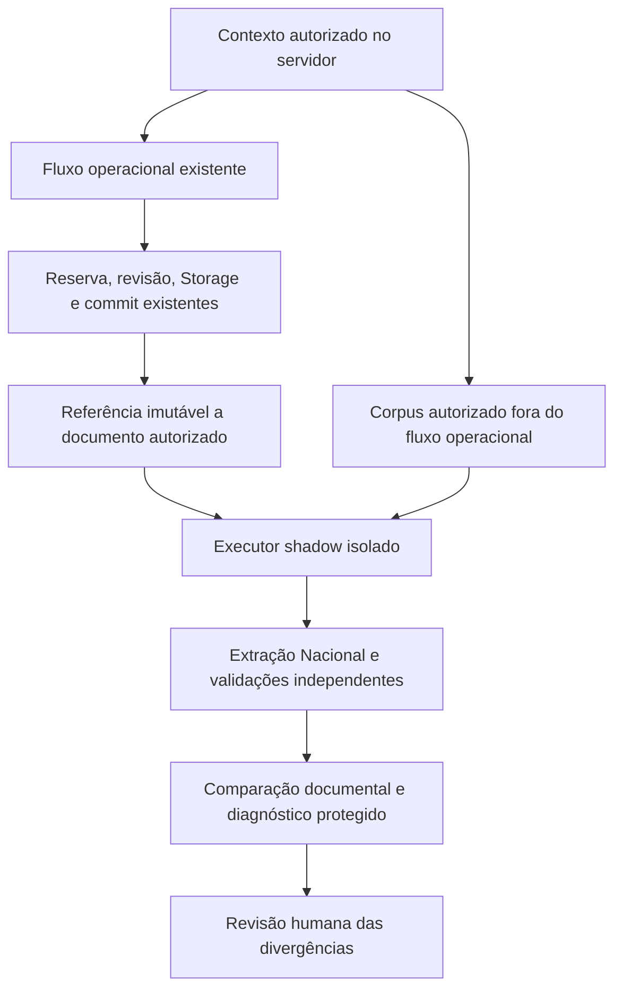

# Shadow mode Nacional — proposta para uma etapa posterior

Esta arquitetura é uma proposta. E2.5 não implementou hooks, filas, rotas,
tabelas, RPCs, persistência de diagnóstico ou integração ao dispatcher.
A recomendação de integração continua **BLOCKED**.

## Controles existentes que a proposta deve preservar

- [parse.server.ts](../../../src/lib/fiscal-intake/parse.server.ts): XML operacional
  segue o parser de NF-e e a chave de 44 dígitos. O adaptador Nacional usa outro
  contrato e não pode ocupar esse caminho implicitamente.
- [service.server.ts](../../../src/lib/fiscal-intake/service.server.ts): extração,
  resolução de escopo, reserva ou retomada de revisão, preparação financeira,
  revisão, Storage e commit cercado por token/geração são etapas distintas.
- [repository.server.ts](../../../src/lib/fiscal-intake/repository.server.ts):
  `fiscal_intake_resolve_scope`, `fiscal_intake_reserve`, preparação de Storage,
  commit e recuperação encapsulam os controles de persistência.
- [manual.server.ts](../../../src/lib/fiscal-intake/manual.server.ts): sessão,
  MFA e contexto são conferidos novamente depois de processamento potencialmente
  demorado. Fundo, ator e vínculo não são autorizados pelo payload.
- [prepare.ts](../../../src/lib/fiscal-intake/prepare.ts) e
  [persistence.ts](../../../src/lib/nfse/persistence.ts): a projeção para os
  valores operacionais é uma decisão separada da extração documental.
- As migrations existentes de identidade/fencing, commit atômico e reconciliação
  documental foram apenas consultadas. Seus bytes e efeitos foram preservados.

## Fluxo proposto

Não existe seta de retorno do diagnóstico para a aprovação financeira. Falha,
timeout, documento incompatível ou divergência no shadow não altera a importação
principal, o saldo, as parcelas, a aprovação ou os documentos históricos.

## Contratos e responsabilidades futuros

1. **Entrada autorizada:** referência do documento, hash dos bytes, versão
   imutável, fundo e vínculo resolvidos no servidor, origem manual/e-mail e ator
   ou identidade técnica autorizada. Não aceitar caminhos arbitrários de Storage
   nem usar CNPJ extraído pelo candidato para conceder acesso.
2. **Leitura:** porta própria de leitura do documento, submetida às mesmas
   verificações de autorização. `service_role` é capacidade técnica; não é uma
   autorização de negócio. Revalidar o vínculo antes de disponibilizar o resultado.
3. **Executor:** chamar o adaptador isolado sob limite de bytes, profundidade,
   nós, atributos, CPU e tempo. Não chamar `reserve`, `planStorage`, `commit`,
   `openReview` ou as projeções financeiras com a saída candidata.
4. **Comparação:** guardar versão do extrator, parser, contrato, pacote XSD,
   validador, hashes dos schemas e documento, campo, estado, evidência e causa da
   diferença. Relatar `AUSENTE`, zero, `INVALIDO`, `DERIVADO` e `NAO_APLICAVEL`
   separadamente. Não sintetizar datas ou situação fiscal ativa.
5. **Diagnóstico protegido:** acesso pelo mesmo escopo de fundo/cedente, conteúdo
   sensível fora de logs públicos, retenção explícita e trilha de auditoria.
   Não armazenar signed URLs, tokens, OTPs ou credenciais. A escolha desse
   repositório e suas eventuais migrations exige uma autorização posterior.
6. **Idempotência de análise:** chave lógica sugerida composta por escopo
   autorizado + documento/versão/hash + extrator + contrato + perfil XSD + parser.
   Uma análise repetida não cria NF nem disputa a reserva fiscal operacional.
7. **Agendamento:** para documentos já persistidos, referência emitida após o
   commit confirmado; uma outbox, se escolhida, deverá preservar atomicidade em
   implementação futura. A falha de publicação não pode desfazer a operação.

Há uma limitação importante: hoje o XML Nacional falha no parser operacional de
NF-e antes de obter uma NF persistida. Portanto, um hook apenas depois do commit
não fornecerá corpus desses XMLs. A primeira fase deve usar um corpus autorizado
fora desse fluxo. Qualquer captura futura de upload rejeitado exigirá desenho de
consentimento, autorização, retenção e armazenamento; não pode ser acrescentada
silenciosamente a esta proposta.

## Gates para implementação e liberação

| Gate | Prova exigida |
| --- | --- |
| Corpus fiscal | XMLs emitidos ou de homologação oficial, com origem documentada; pares DANFSe quando disponíveis |
| Perfis | Pacote de produção e comportamento de `TSSerieDPS` esclarecidos; nenhum fallback silencioso para homolog |
| Contrato | Decisão sobre prestador versus emitente e emissão documental versus processamento; contrato versionado se necessário |
| Versões | Política documentada para NFS-e 1.01 com DPS 1.00; testes oficiais antes de alterar a rejeição |
| Parser | Todos os negativos obrigatórios rejeitados; biblioteca mantida ou estratégia de manutenção aprovada |
| Autorização | Testes negativos entre fundos/cedentes, vínculo revogado, MFA/contexto expirado e identidade conflitante |
| Compatibilidade | NF-e 44 dígitos, upload, e-mail, revisão, idempotência, recuperação de Storage e commit preservados |
| Elegibilidade | CPF, zero, cancelamento e status desconhecido extraídos sem autorização automática de antecipação |
| Operação | Flag desativada por padrão, canário autorizado, métricas separadas e interrupção sem modificar dados históricos |

Uma futura liberação de shadow mode não equivale à liberação de importação
financeira. Substituição do parser, dispatcher e persistência serão decisões
posteriores e separadas.
